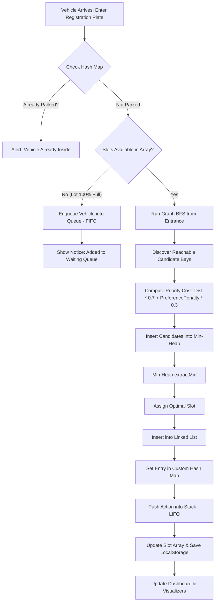
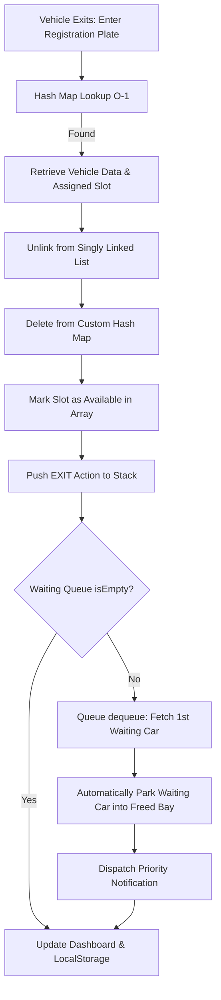

# ParkWise – DSA Based Smart Parking Management System

> **Tagline:** *Park Smarter. Powered by DSA.*  
> **Author:** Lakshay Kumar  
> **Course:** Bachelor of Technology in Computer Science & Engineering (B.Tech CSE)  
> **Submission:** College DSA Capstone Project / Viva Voce Defense  

---

## 📌 Project Overview

**ParkWise** is an advanced, algorithmically genuine **Smart Parking Management System** engineered from scratch using pure client-side web technologies (HTML5, Vanilla CSS3, and ES6+ JavaScript). 

Unlike standard CRUD parking applications that merely store entries in a simple table, **ParkWise is built ground-up upon foundational Data Structures and Algorithms (DSA)**. Every single user operation—from car admission and fast license plate lookup to automatic queue promotion and smart slot recommendation—directly executes custom-implemented data structures and graph algorithms without third-party frameworks or external libraries.

The application also features a comprehensive **Live DSA Visualizer**, an interactive **Searching & Sorting Laboratory**, and a dedicated **B.Tech Viva Voce Preparation Suite**.

---

## 🚀 Key Features

1. **Real-Time Interactive Parking Grid**:
   - 24 physical bays organized into 4 distinct zones (Zone A: Near Entrance, Zone B: Central, Zone C: East Wing, Zone D: Covered/EV Charging).
   - Real-time status indicators (Available: Green, Occupied: Red, Optimal: Cyan glow).
   - Zone-level and status-level live filtering.

2. **Smart Slot Recommendation Engine**:
   - Traverses the parking zone network using **Graph Breadth-First Search (BFS)** starting from the Entrance.
   - Evaluates reachable available bays against a dynamic **Priority Cost Function** taking into account distance and driver preferences (EV bays, VIP/compact bays).
   - Inserts candidates into a **Min-Heap / Priority Queue** and extracts the single optimal parking bay via `extractMin()` in logarithmic $O(\log k)$ time.

3. **High-Speed Vehicle Admission & Exit**:
   - **Admission**: Checks duplicates via $O(1)$ Hash Map, allocates the optimal bay, links node into active `LinkedList`, records in `CustomHashMap`, pushes event onto `Stack`, and updates the slot `Array`.
   - **Exit**: Instant $O(1)$ Hash Map lookup, unlinks vehicle from `LinkedList`, frees slot, calculates billable parking fees, records exit in `Stack`, and checks the waiting line.

4. **Automated FIFO Waiting Queue (Fair Buffer Allocation)**:
   - When all 24 slots are occupied, incoming vehicles are enqueued into a custom **FIFO Queue**.
   - As soon as any parked vehicle exits, the system **automatically dequeues** the first waiting driver and promotes them into the newly freed bay without manual intervention!

5. **DSA Visualizer Suite (All 8 Structures)**:
   - **Array Visualizer**: Memory cell indexing from index `0` to `23`.
   - **Linked List Visualizer**: Dynamic node pointer representation `[HEAD] ➔ [CAR] ➔ [CAR] ➔ NULL`.
   - **Queue Visualizer**: Horizontal FIFO pipeline highlighting `FRONT` and `REAR`.
   - **Stack Visualizer**: Vertical LIFO canister showing push/pop operations with `TOP (Peek)` indicator.
   - **Hash Map Visualizer**: Visual representation of the 11 buckets and separate chaining linked nodes.
   - **Binary Search Tree (BST)**: Scalable SVG hierarchical tree diagram with interactive **Inorder Traversal**.
   - **Min-Heap Visualizer**: Dual representation (Flat Array indexing formula + Complete Binary Tree root).
   - **Interactive Graph Visualizer**: SVG canvas modeling zones and slots with animated **BFS** and **DFS** traversals!

6. **Search & Sort Interactive Laboratory**:
   - **Searching**: Interactive comparison between **Linear Search** ($O(n)$) and **Binary Search** ($O(\log n)$) with step-by-step pointers (`low`, `mid`, `high`) and comparison counters.
   - **Sorting**: Real-time bar animation comparing **Bubble Sort** ($O(n^2)$) and **Selection Sort** ($O(n^2)$) on bay distances with animated swap indicators and speed controls.

7. **Complete Persistence & Audit Trail**:
   - Complete state preservation via **HTML5 LocalStorage** across browser restarts.
   - Exportable audit log with timestamped history of all park, exit, and enqueue operations.
   - 1-Click "Load Demo Data" and "System Reset" tools.

---

## 🧠 Data Structures Implemented

Every data structure in ParkWise is manually authored in standard JavaScript ES6 classes without relying on prebuilt helper libraries:

| # | Data Structure | Class / Identifier | Real-World Role in ParkWise |
|---|---|---|---|
| 1 | **Array** | `parkingSlots = [...]` | Represents the 24 fixed physical parking bays with constant-time index access. |
| 2 | **Singly Linked List** | `class LinkedList` | Stores currently active parked vehicles dynamically with $O(1)$ insertion and pointer unlinking. |
| 3 | **Queue (FIFO)** | `class Queue` | Buffers waiting vehicles during rush hour; guarantees strict first-come-first-served fairness. |
| 4 | **Stack (LIFO)** | `class Stack` | Records recent parking/exit operations for inspection, auditing, and undo capabilities. |
| 5 | **Custom Hash Map** | `class CustomHashMap` | Maps vehicle license plate strings to vehicle data using a polynomial rolling hash and separate chaining. |
| 6 | **Binary Search Tree (BST)** | `class BST` | Indexes parking bays by distance from entrance for sorted range queries and logarithmic lookup. |
| 7 | **Min-Heap (Priority Queue)** | `class MinHeap` | Powers the smart recommendation engine; root node constantly guarantees minimum priority score. |
| 8 | **Graph (Adjacency List)** | `class ParkingGraph` | Models physical corridors and pathways between Entrance, Zone hubs, and individual parking bays. |

---

## ⚡ Algorithms & Complexity Analysis

| Algorithm | Type | Implementation | Time Complexity | Space Complexity |
|---|---|---|---|---|
| **Graph BFS** | Traversal / Pathfinding | `parkingFacilityGraph.bfs("Entrance")` | $O(V + E)$ | $O(V)$ |
| **Graph DFS** | Deep Zone Exploration | `parkingFacilityGraph.dfs("Entrance")` | $O(V + E)$ | $O(V)$ |
| **Min-Heap Extract** | Priority Selection | `smartMinHeap.extractMin()` | $O(\log k)$ | $O(1)$ |
| **Min-Heap Insert** | Priority Insertion | `smartMinHeap.insert(candidate)` | $O(\log k)$ | $O(1)$ |
| **Hash Map Get** | Key-Value Lookup | `vehicleHashMap.get(regNo)` | Average $O(1)$, Worst $O(n)$ | $O(n)$ |
| **Linear Search** | Sequential Search | `linearSearch(array, key, target)` | $O(n)$ | $O(1)$ |
| **Binary Search** | Divide & Conquer | `binarySearch(sortedArray, key, target)` | $O(\log n)$ | $O(1)$ |
| **Bubble Sort** | Comparison Sort | `bubbleSort(array, key)` | $O(n^2)$ | $O(1)$ |
| **Selection Sort** | Selection Sort | `selectionSort(array, key)` | $O(n^2)$ | $O(1)$ |
| **BST Inorder Traversal** | Tree Traversal | `slotsBST.inorderTraversal()` | $O(n)$ | $O(h)$ |

---

## 🔄 End-to-End Workflows

### 1. Vehicle Entry Workflow


### 2. Vehicle Exit Workflow & Queue Handoff


---

## 🛠️ Technology Stack

- **Markup:** Semantic HTML5 (`index.html`) with ARIA accessibility roles and metadata.
- **Styling:** Modern Vanilla CSS3 (`style.css`) with CSS custom properties, glassmorphism, responsive flex/grid layouts, and micro-animations.
- **Logic:** Native ES6+ JavaScript (`script.js`) strictly implementing all classes and algorithms.
- **Persistence:** HTML5 LocalStorage API.
- **Typography:** Google Fonts (*Outfit*, *Inter*, *JetBrains Mono*).
- **Zero External Frameworks**: No React, Vue, Angular, jQuery, Tailwind, or external NPM runtime dependencies.

---

## 📁 Project Structure

```
ParkWise/
│
├── index.html       # Single-page application shell containing 8 responsive sections & modals
├── style.css        # Complete modern dark dashboard design system & DSA visualizer styles
├── script.js        # Pure ES6 implementation of all 8 data structures, search/sort algorithms & UI logic
├── README.md        # Comprehensive project documentation, DSA mapping, and viva guide
└── .gitignore       # Git ignore rules for clean repository hygiene
```

---

## 💻 How to Run the Project Locally

Because ParkWise uses pure vanilla web technologies, running the project requires **no installation, no npm builds, and no background database server**:

### Method 1: Direct Browser Launch
1. Clone or download the repository to your computer:
   ```bash
   git clone https://github.com/lakshaykumar/parkwise.git
   ```
2. Navigate into the `Parkwise` folder.
3. Double-click `index.html` or right-click and choose **Open with Google Chrome / Microsoft Edge / Firefox / Brave**.

### Method 2: Using VS Code Live Server
1. Open the `Parkwise` folder in **Visual Studio Code**.
2. Install the **Live Server** extension (if not already installed).
3. Right-click `index.html` and select **"Open with Live Server"**.
4. The dashboard will automatically launch at `http://127.0.0.1:5500`.

### Method 3: Using Python Built-in HTTP Server
In your terminal, navigate to the project directory and run:
```bash
# Python 3
python -m http.server 8000
```
Open your browser and navigate to `http://localhost:8000`.

---

## 🎓 College Viva Voce Defense Guide (Frequently Asked Questions)

### Q1: Why did you use a Min-Heap instead of simply sorting the array for slot recommendation?
> **Answer:** Sorting an entire array takes $O(n \log n)$ time. With a Min-Heap, we insert only candidate slots ($k \le n$) and extract the absolute minimum in $O(\log k)$ time (or inspect the top in $O(1)$). When slots continuously free up in real time, inserting each newly available slot into the existing heap takes only $O(\log k)$ without having to re-sort the whole array.

### Q2: Why is Breadth-First Search (BFS) used instead of Depth-First Search (DFS) for reachable slots?
> **Answer:** BFS explores nodes level by level (nodes with 1 edge distance, then 2 edges distance, etc.). In an unweighted graph representing parking corridors, BFS is guaranteed to discover the shortest path and nearest reachable available slot from the entrance gate. DFS can traverse down a remote dead-end path before backtracking.

### Q3: How does your Custom Hash Map handle collisions?
> **Answer:** Our hash map uses a polynomial rolling hash function modulo capacity ($11$):
> $$\text{hash}(key) = \left(\sum_{i=0}^{L-1} \text{char}(i) \times 31^i\right) \pmod{11}$$
> If two license plates hash to the same bucket index, we resolve collisions using **Separate Chaining**, appending linked entries inside that bucket array. Lookup time remains average $O(1)$.

### Q4: Why maintain both an Array and a Singly Linked List for parked vehicles?
> **Answer:** The **Array** represents physical, fixed infrastructure (the 24 physical bays that always exist). The **Linked List** represents dynamic occupancy (only active cars). If only 3 cars are parked, iterating through the Linked List visits only 3 nodes, whereas scanning the parking lot array requires checking all 24 slots.

### Q5: What happens when all parking bays are occupied?
> **Answer:** The system triggers the **Queue (FIFO)** discipline. Incoming vehicles are placed into the waiting buffer. When any existing vehicle exits, the system automatically performs an atomic dequeue and assigns the newly freed bay to the first waiting driver.

---

## 🔮 Future Scope

- **Dijkstra's Shortest Path Algorithm**: Incorporating weighted lane distances and driving turn delays into the graph.
- **AVL / Red-Black Self-Balancing Tree**: Upgrading the standard BST to guarantee $O(\log n)$ height balance under continuous insertions.
- **IoT & OpenCV Integration**: Connecting the web application to physical ultrasonic sensors and automatic license plate recognition (ALPR) camera feeds via WebSockets.
- **PWA (Progressive Web App)**: Enabling offline field operation and service-worker caching for parking attendants.

---

## 👨‍💻 Author

- **Name:** Lakshay Kumar  
- **Degree:** Bachelor of Technology in Computer Science & Engineering (B.Tech CSE)  
- **Project:** ParkWise – Smart Parking Management System  
- **GitHub Submission:** [https://github.com/lakshaykumar/parkwise](https://github.com/lakshaykumar/parkwise)  
